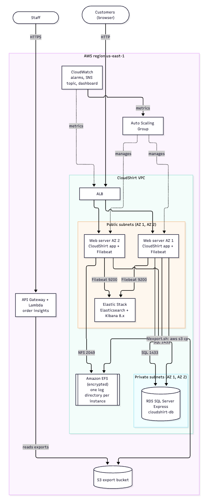
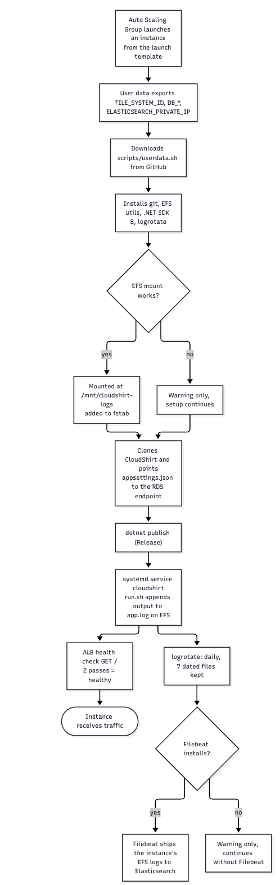
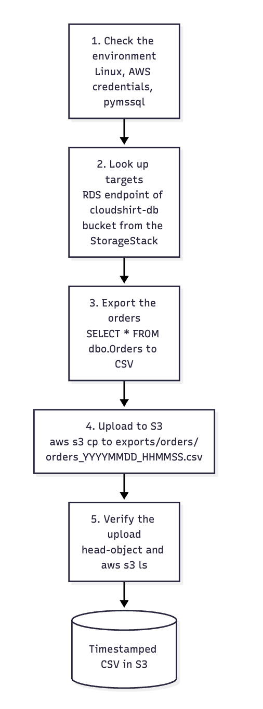
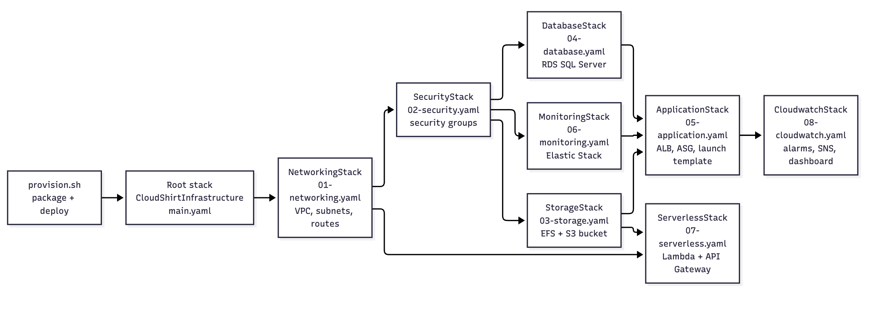

# Report 
**Mihaela Stoyanova, Krisztián Kozári**

## Introduction 
The goal of this project is to design and deploy a cloud infrastructure for CloudShirt, a startup company from Germany. The solution uses Amazon Web Services (AWS) and AWS CloudFormation to automate the deployment and configuration of the infrastructure.
The application is based on the CloudShirt ASP.NET Core 8.0 web application. The infrastructure includes a Virtual Private Cloud (VPC), subnets across multiple Availability Zones, security groups, Amazon EC2, an Application Load Balancer (ALB), an Auto Scaling Group, Amazon Elastic File System (EFS), Amazon RDS, Amazon S3, and an Elastic Stack monitoring solution.
The infrastructure is divided into separate CloudFormation templates. A master template, main.yaml, orchestrates the deployment of the individual components. A UserData script automates the installation and configuration of the CloudShirt application on EC2 instances.
The main objectives are to provide high availability, support scheduled scaling, store application logs centrally, provision a relational database using Infrastructure as Code, and provide monitoring and serverless functionality.

## Solution overview
CloudShirt is a startup from Germany that wants to run its .NET web shop on AWS. This solution deploys the CloudShirt ASP.NET Core 8 application with one command. A single CloudFormation root stack, CloudShirtInfrastructure, creates eight nested stacks. Customers reach the shop through one Application Load Balancer URL, which spreads traffic over web servers in two Availability Zones. The servers use a private Amazon RDS for SQL Server database, write their logs to Amazon EFS and ship them with Filebeat to an Elastic Stack. A script exports the order table to S3, and a serverless API reads those exports.

## Learning objectives 

Cloud infrastructure and AWS services: The solution uses AWS services including EC2, VPC, Elastic Load Balancing, EFS, RDS, S3, AWS Lambda, API Gateway, and CloudFormation.

| Learning objective | Where it is covered? | How? |
| --- | --- | --- |
| Networking | `01-networking.yaml` | A VPC with public subnets for the ALB and web servers and private subnets that only hold the database, each pair spread over two AZs, with separate route tables. |
| Security | `02-security.yaml`, `03-storage.yaml` | Security groups are chained: internet to ALB, ALB to web servers, web servers to EFS (2049), RDS (1433) and Elasticsearch (9200). EFS is encrypted, the S3 bucket blocks public access and uses SSE. |
| Compute and scaling | `05-application.yaml` | Launch template with Amazon Linux 2023, Auto Scaling Group with 2 to 4 instances, scheduled scaling actions. |
| Load balancing and high availability | `05-application.yaml` | Internet-facing ALB over two AZs, target group with ELB health checks, instances replaced automatically when unhealthy. |
| Storage | `03-storage.yaml` | EFS for shared application logs, S3 for order exports. |
| Databases | `04-database.yaml` | RDS for SQL Server in a DB subnet group over two private subnets, snapshot on deletion. |
| Monitoring and logging | `06-monitoring.yaml`, `08-cloudwatch.yaml`, `userdata.sh `| Elastic Stack with Filebeat for logs, CloudWatch alarms, SNS topic and dashboard for metrics. |
| Serverless | `07-serverless.yaml` | Lambda and API Gateway reading the S3 exports. |
| Infrastructure as code and automation | main.yaml, provision.sh | Nested stacks, `aws cloudformation package` and `deploy`, one script for create, update and delete. |

## Requirements 
| REQ | Solution | Files |
| --- | --- | --- |
| REQ-01 | The CloudShirt .NET application runs in an EC2 Auto Scaling Group with a minimum of two instances, distributed across two Availability Zones and registered behind an Application Load Balancer. The ALB provides a single URL for accessing the application and distributes traffic between the available instances. | [05-application.yaml](../templates/05-application.yaml) - launch template, ALB, target group and Auto Scaling Group [01-networking.yaml](../templates/01-networking.yaml) - VPC and subnets in two AZs [userdata.sh](../scripts/userdata.sh) - installs and starts the application |
| REQ-02 | The Auto Scaling Group has two scheduled actions: it scales out from 2 to 4 instances at 18:00 Eastern Time and scales back to 2 instances at 20:00 (time zone `America/New_York`). This lets the application handle the expected peak in traffic. | [05-application.yaml](../templates/05-application.yaml) - scheduled scale-out and scale-in actions |
| REQ-03 | EFS is provisioned with CloudFormation, with mount targets in both Availability Zones, and mounted on the web servers at `/mnt/cloudshirt-logs`. Each instance writes its application log to its own directory on the shared file system and logrotate rotates it daily into dated files. The logs are therefore stored centrally and remain available when instances are replaced or scaled. | [03-storage.yaml](../templates/03-storage.yaml) - EFS file system and mount targets [02-security.yaml](../templates/02-security.yaml) - EFS security group (NFS port 2049) [userdata.sh](../scripts/userdata.sh) - mount, log directory and daily log rotation |
| REQ-04 | An Amazon RDS SQL Server database is provisioned with CloudFormation in the private subnets and only accepts connections from the web servers. The application connects through the RDS endpoint. Database credentials and connection information are passed to the instances through CloudFormation parameters. | [04-database.yaml](../templates/04-database.yaml) - RDS instance and subnet group [02-security.yaml](../templates/02-security.yaml) - database security group (port 1433) [05-application.yaml](../templates/05-application.yaml) - passes endpoint and credentials to the user data |
| REQ-05 | The `06-monitoring.yaml` template provisions an Elastic Stack instance with Elasticsearch and Kibana v8.x. Elasticsearch receives the log data, while Kibana provides a web interface (port 5601) for searching and analysing it. | [06-monitoring.yaml](../templates/06-monitoring.yaml) - Elastic Stack instance [02-security.yaml](../templates/02-security.yaml) - monitoring security group [08-cloudwatch.yaml](../templates/08-cloudwatch.yaml) - extra: CloudWatch alarms and dashboard |
| REQ-06 | The UserData script installs Filebeat on each application instance. It collects the instance's own application logs from `/mnt/cloudshirt-logs/<hostname>/app.log*` and the system log `/var/log/messages` and sends them to Elasticsearch. A Filebeat failure does not stop the application setup. | [userdata.sh](../scripts/userdata.sh) - Filebeat installation and configuration [06-monitoring.yaml](../templates/06-monitoring.yaml) - provides the Elasticsearch address |
| REQ-07 | The script `export.sh` exports the Orders table from the RDS database to a CSV file with a UTC timestamp in its name and uploads it to the S3 export bucket (`exports/orders/`) with the AWS CLI. It runs on a web server because the database is private, and it can be run repeatedly. | [export.sh](../scripts/export.sh) - the export script [03-storage.yaml](../templates/03-storage.yaml) - the S3 export bucket |
| REQ-08 | The `07-serverless.yaml` template provisions an AWS Lambda function exposed through an API Gateway REST API. The function summarises the order exports that the REQ-07 script writes to the `exports/orders/` prefix in Amazon S3 and returns them over four read-only routes, so staff can see order totals, buyer counts and, where the export carries prices, unit counts and best-selling products without opening the database. The function is provisioned entirely through CloudFormation and uses an IAM role that can only list and read that prefix. | [07-serverless.yaml](../templates/07-serverless.yaml) - Lambda, API Gateway and IAM role [insights.py](../lambda/order_insights/insights.py) - the Lambda code [main.yaml](../templates/main.yaml) - passes the bucket name and ARN to the stack |

## Application deployment 

`05-application.yaml` creates everything that serves the CloudShirt shop: the load balancer, the web servers and the scaling rules. It covers `REQ-01` (high availability behind one URL) and `REQ-02` (scale out between 18:00 and 20:00 Eastern). The web servers set themselves up with userdata.sh, which also covers the mounting side of `REQ-03` and the Filebeat part of `REQ-06`.

The launch template passes the settings to every new instance as environment variables and downloads `userdata.sh` from GitHub. The EFS mount and Filebeat steps are allowed to fail without stopping the application. The load balancer starts sending traffic as soon as the health check passes.

### Serverless component

`07-serverless.yaml` is deployed by `main.yaml` as the `ServerlessStack` nested stack. It depends on the storage stack and receives the export bucket name and its ARN from it, so the Lambda reads the same bucket that the REQ-07 export script writes to. The `DeploymentVersion` parameter is declared on the root stack and forwarded to the serverless stack.

The function reads the order exports from Amazon S3 instead of querying Amazon RDS directly. This keeps the component independent of the database: the CloudShirt application seeds data at startup but never applies EF Core migrations, so the schema is created out of band. Reading the exports also means the endpoint still works during the period when the database has no tables.

| Resource | Purpose |
| -------- | ------- |
| `InsightsLogGroup` | CloudWatch log group `/aws/lambda/CloudShirt-OrderInsights`, kept for 14 days. |
| `InsightsRole` | IAM role for the function. It may list the bucket for the `exports/orders/` prefix and read objects under it, and has no other access. |
| `OrderInsightsFunction` | AWS Lambda function `CloudShirt-OrderInsights`. It runs on Python 3.12, has 256 MB of memory and a 30 second timeout, and reads the bucket name from the `ORDER_EXPORT_BUCKET` environment variable. |
| `Api` | API Gateway REST API `CloudShirt-Order-Insights`, regional endpoint. |
| `ApiProxyResource` | The `{proxy+}` resource, so every path reaches the same function. |
| `ApiProxyMethod` | The `ANY` method using a Lambda proxy integration. Routing happens inside the function. |
| `ApiDeployment` | API Gateway deployment. It carries the `DeploymentVersion` value in its description. |
| `ApiStage` | The `prod` stage, throttled to 20 requests per second with a burst of 40, with detailed metrics enabled. |
| `ApiInvokePermission` | Allows API Gateway to invoke the function. |

The function serves four routes: `GET /health` returns the service name and bucket, `GET /exports` lists the CSV files under `exports/orders/` and gives each one an `id`, `GET /exports/{id}` summarises a single export, and `GET /summary` totals every export and returns a per-export series.

The export script names its files `orders_YYYYMMDD_HHMMSS.csv`, so each run produces a new object rather than overwriting the previous one. The function accepts that naming and also the `orders-YYYY-MM-DD.csv` form, and takes the part after `orders_` or `orders-` as the export's `id`.

Because `scripts/export.sh` runs `SELECT *` against the `Orders` table alone, its exports contain no prices or quantities: those columns live in the separate `OrderItems` table. The endpoint therefore reports order and buyer counts as measurements, and returns `null` for units, revenue and best-selling products, naming them in `unavailableMetrics`. This is the intended behaviour rather than a failure, and an export that joins `OrderItems` fills those fields in with no change to the infrastructure.

The order export columns are matched by name rather than by position, and each column accepts the spellings it is likely to arrive as, for example `order_id`, `OrderID` or `Id` for the order number and `qty` or `units` for the quantity. A column that cannot be found is treated as absent, and the metrics that depend on it are returned as `null` and named in `unavailableMetrics`. This means an export of the `Orders` table alone still produces a useful response, even though prices and quantities only exist in the `OrderItems` table.

The stack outputs `ApiEndpoint`, the invoke URL of the API, and `OrderInsightsFunctionName`, the name of the function.

### CloudWatch monitoring

`08-cloudwatch.yaml` is deployed by `main.yaml` as the `CloudwatchStack` nested stack. It depends on the application stack and receives the Auto Scaling Group name, the load balancer full name (`app/<name>/<id>`) and the target group full name (`targetgroup/<name>/<id>`) from it.

| Resource | Purpose |
| -------- | ------- |
| `AlarmTopic` | Amazon SNS topic `CloudShirt-Alarms` that every alarm publishes to. The email subscription is created only when `AlarmEmail` is set, because an empty endpoint is not valid. |
| `CloudShirtHighCpuAlarm` | Alarm `CloudShirt-HighCPU`. Fires when the average `CPUUtilization` of the Auto Scaling Group is above 70% for two consecutive 5-minute periods. |
| `CloudShirtALBUnhealthyHostAlarm` | Alarm `CloudShirt-ALB-Unhealthy-Host`. Fires when the maximum `UnHealthyHostCount` of the target group reaches one, so a single target failing its ALB health checks is reported. |
| `CloudShirtDashboard` | CloudWatch dashboard `CloudShirt-Overview` with widgets for ASG CPU utilisation, ALB request count, ALB target response time, healthy vs. unhealthy targets, and ALB 5XX errors. |

Both alarms set `TreatMissingData` to `notBreaching`, so a period without metric data does not raise a false alarm. The stack outputs `AlarmTopicArn`, the SNS topic that the alarms publish to, and `CloudShirtDashboardOutput`, the name of the dashboard.

## Justification of choices 
| Choice | Reason | Trade-off |
| --- | --- | --- |
| One root stack with nested stacks | Clear separation by layer, reusable outputs, one create or delete command | Needs packaging; a failed child stack rolls back the whole root stack |
| Web servers in public subnets, database in private subnets | No NAT gateway cost; the database is not reachable from the internet | Web servers have public IPs and rely on security groups |
| RDS SQL Server Express | The CloudShirt application is built for SQL Server; the Express edition is the cheapest | Single AZ, size limits |
| EFS directory per instance plus logrotate | Shared storage survives instance replacement, and separate directories avoid interleaved logs and duplicate indexing | Only application output goes to EFS |
| Export script runs on EC2 | The database is private, so the script has to run inside the VPC | Needs an instance profile and a running web server |
| `LabInstanceProfile` for instances | AWS Academy does not allow custom instance roles | Broader permissions than a least-privilege role |
| User data downloaded from GitHub | Instances stay small and the script is versioned; `provision.sh` passes the URL as a parameter | The repository must be readable by the instances; changes must be on `main` |
| Single-node Elastic Stack with security disabled | Simplest setup for a lab (REQ-05, REQ-06) | Not suitable for production |
| CloudWatch alarms and dashboard as an extra stack | Metrics and alerting for the ALB and ASG next to the log analysis in Elastic | Alarm email is optional and empty by default |

### Provision flow 

## 6. Roll-out

1. **Prerequisites:** AWS CLI v2, active AWS Academy credentials (refresh them whenever the lab restarts), the key pair `vockey`, and the repository pushed to GitHub with `scripts/userdata.sh` on `main`.
2. **Deploy:** run `bash scripts/provision.sh`. It checks the credentials, creates the staging bucket `cloudshirt-cfn-staging-<account id>`, packages the nested templates and the Lambda code, and creates or updates the root stack. This takes more than 10 minutes; RDS is the slowest part. Options include `--region`, `--stack-name`, `--key-name`, `--db-username`, `--db-password`, `--delete` and `--yes`.
3. **Outputs:** the script prints the outputs of the root and nested stacks: `LoadBalancerDNS` (shop URL), `KibanaURL`, `OrderInsightsApiEndpoint` and `OrderExportBucketName`.
4. **Verify:** open `http://<LoadBalancerDNS>`; check that the targets are healthy; place a test order; run `scripts/export.sh` on a web server and list the bucket; open Kibana on port 5601 and look for the logs; call the API endpoint.
5. **Tear down:** `bash scripts/provision.sh --delete`. The export bucket (`DeletionPolicy: Retain`), the staging bucket and the final RDS snapshot are kept on purpose and can be removed manually.

Stack updates change the launch template, but running instances are not replaced automatically. Start an instance refresh on the Auto Scaling Group or replace the instances to apply the change.

## Recommmendations 
- **Secrets:** the database password has a default in the templates and is passed through user data. Use AWS Secrets Manager or SSM Parameter Store and remove the defaults.
- **Network exposure:** SSH (22) and Kibana (5601) are open to the internet and the web servers still allow direct port 80 access. Restrict them to known IP ranges, use SSM Session Manager instead of SSH, and remove the temporary port 80 rule.
- **HTTPS:** add an ACM certificate and an HTTPS listener (with a Route 53 name) so that customers do not use plain HTTP.
- **Database availability:** enable Multi-AZ and encryption for RDS, and move to a larger edition for production.
- **Monitoring:** enable Elastic security and run more than one node, or use Amazon OpenSearch Service. Add a CloudWatch agent for memory and disk metrics.
- **Log coverage:** only application output goes to EFS. Check that `/var/log/messages` exists on Amazon Linux 2023 or switch that input to the journal.
- **Scaling:** add target tracking on CPU or request count next to the scheduled actions, so that unexpected spikes are handled too.
- **Automation:** run the export on a schedule with EventBridge and SSM, and add a CI pipeline with `cfn-lint` and a deployment test.
- **Cost and cleanup:** add lifecycle rules to the export bucket and clean up retained buckets after redeployments.

## Conclusion 

The project defines a modular AWS infrastructure for the CloudShirt application using CloudFormation. The application tier is designed to support high availability across two Availability Zones and scheduled scaling between 18:00 and 20:00 Eastern Time. The solution also provisions EFS, RDS, an Elastic Stack monitoring environment, a CloudWatch stack with alarms, SNS notifications and a dashboard, and a separate serverless stack.

The configuration addresses the main infrastructure requirements, but some capabilities must be confirmed through deployment and testing. In particular, successful Filebeat log delivery, daily log rotation, the scripted RDS order export, the confirmation of the SNS alarm subscription, and the deployed order insights endpoint require verification before the project can be reported as fully complete.